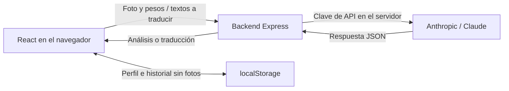

# TicketNova · Ticket Analyzer

Analiza una foto de tu ticket de supermercado y descubre qué productos mantener, reducir o añadir en tu próxima compra.

Aplicación web construida con **React y Express**, con lectura de imágenes mediante **Claude**, clasificación orientativa inspirada en **NOVA**, recomendaciones según el objetivo indicado, cinco idiomas e historial local por perfil.

## Cómo se usa

1. **Completa tu perfil.** Introduce tu nombre, peso actual y peso objetivo. Los pesos admitidos van de 30 a 250 kg; puedes indicar el mismo valor para mantenerlo.
2. **Sube tu ticket.** Elige una foto completa y legible en JPG, PNG, WEBP o GIF. No necesitas instalar ninguna aplicación.
3. **Revisa tus próximos pasos.** Consulta la distribución de tu compra, los productos a mantener o reducir y las alternativas a añadir. Puedes descargar la lista de compra como archivo de texto.

Si el perfil ya está completo y guardado, en la siguiente visita se pasa directamente al ticket.

## Funciones

- **Recorrido guiado:** perfil → ticket → resultados, con indicación del paso actual.
- **Lectura del ticket con IA:** extracción de productos, cantidades, precios, supermercado, fecha y moneda cuando son legibles.
- **Panel de resultados:** métricas de gasto, gráfico de distribución y tabla de productos con filtros por categoría.
- **Recomendaciones de compra:** productos a mantener, productos a reducir y alternativas para la siguiente compra.
- **Perfil local:** nombre y pesos guardados en el navegador, sin registro de cuenta.
- **Historial opcional:** los últimos 20 análisis del perfil, con apertura y borrado individual o completo.
- **Cinco idiomas:** español, inglés, polaco, ruso y bielorruso, con detección automática del idioma del ticket y selección manual.
- **Lista descargable:** exportación en `.txt` con los productos y los precios conocidos del ticket.

### Idiomas

El modo **Automático · ticket** detecta el idioma del texto durante el análisis. La interfaz, los nombres de alimentos, las recomendaciones y la lista descargable cambian a ese idioma. Un ticket de Bielorrusia escrito en ruso se analiza en ruso: la detección no se basa únicamente en el país.

Si el idioma es ambiguo o no está entre los cinco disponibles, se utiliza el idioma actual de la interfaz y se permite elegir otro. El nombre original impreso se conserva en `products.originalName`. Las marcas, tiendas, precios y monedas se mantienen.

Cambiar de idioma con un resultado abierto traduce sus campos de texto mediante una llamada adicional a Anthropic. Los importes, la moneda, los totales y las categorías no se sustituyen por la respuesta de traducción. También se rechazan traducciones que cambien los números presentes en los textos. Si falla, se conserva el análisis anterior. Las versiones ya consultadas se reutilizan mientras ese análisis siga abierto.

### Historial vinculado al perfil

En **Perfil**, activa **Guardar mis próximos análisis en este perfil** y pulsa **Guardar**. Los análisis completados a partir de ese momento se guardan automáticamente.

El historial se consulta únicamente desde **Perfil → Mi historial**, cuando estás en los resultados de un análisis. No aparece en la pantalla inicial ni tiene un botón independiente en la cabecera.

- Editar el nombre o los pesos conserva el historial: la vinculación utiliza un identificador local estable.
- Cada compra conserva el idioma del análisis y los pesos utilizados en aquel momento.
- Desactivar el guardado detiene las nuevas entradas y conserva las existentes.
- **Borrar perfil e historial** elimina ambos. Un perfil nuevo con el mismo nombre no hereda las compras borradas.
- Los datos permanecen en ese navegador y dispositivo; no hay sincronización entre dispositivos.

### Precios

La app utiliza importes leídos del ticket y no consulta catálogos externos de supermercados. No asigna precios inventados a las alternativas recomendadas.

En la lista siguiente, un precio solo se reutiliza si el nombre coincide exactamente con una única línea del ticket. Si faltan precios, se indica **Sin precio disponible** y no se calcula un total ni un ahorro. Los importes de una compra anterior no garantizan los de la próxima.

## Tecnologías

| Área | Tecnologías |
| --- | --- |
| Interfaz | React 18, Vite, JavaScript |
| Estilos e iconos | Tailwind CSS, Lucide React |
| Gráficos | Recharts |
| Backend | Node.js, Express |
| IA | Anthropic SDK, Claude con visión |
| Persistencia local | `localStorage` |
| Pruebas | Test runner de Node.js |

## Arquitectura



El backend mantiene la clave de Anthropic fuera del navegador, valida los formatos de imagen, normaliza las respuestas y limita las solicitudes de análisis y traducción. Ambas rutas comparten un límite de 20 solicitudes cada 15 minutos por IP.

## Ejecutar en local

Necesitas **Node.js y npm**. El proyecto se ha trabajado con Node.js 22. Para analizar imágenes y traducir resultados necesitas una clave de Anthropic con acceso al modelo configurado.

### 1. Instalar dependencias

Desde la carpeta del proyecto:

```bash
npm ci
```

### 2. Configurar el entorno

Crea `.env` a partir de [`.env.example`](.env.example), sin sobrescribir uno que ya tengas:

```dotenv
ANTHROPIC_API_KEY=tu_clave_de_anthropic
PORT=3001
FRONTEND_ORIGIN=http://localhost:5173
```

| Variable | Uso |
| --- | --- |
| `ANTHROPIC_API_KEY` | Clave utilizada exclusivamente por el backend para análisis y traducción. |
| `PORT` | Puerto del backend; por defecto, `3001`. |
| `FRONTEND_ORIGIN` | Origen permitido por CORS; por defecto, `http://localhost:5173`. |

El archivo `.env` está excluido mediante `.gitignore`. No pongas la clave en variables `VITE_*`, porque se exponen al frontend.

### 3. Iniciar backend y frontend

En una terminal:

```bash
npm run server
```

En otra:

```bash
npm run dev
```

Abre **http://localhost:5173**. Vite redirige las peticiones `/api` al backend en `http://localhost:3001`. Si cambias ese puerto, ajusta también [vite.config.js](vite.config.js).

Sin `ANTHROPIC_API_KEY`, la interfaz y el endpoint de estado pueden ejecutarse, pero el análisis de imágenes y las traducciones no estarán disponibles.

### Despliegue en Vercel

El frontend se compila con `npm run build` y se publica desde `dist/`. Las funciones de `api/` exponen las rutas de Express para analizar, traducir y comprobar el estado; no hace falta ejecutar `npm run server` en Vercel.

En **Settings → Environment Variables**, añade `ANTHROPIC_API_KEY` con tu clave de Anthropic para los entornos que uses (Production y, si corresponde, Preview). No uses el prefijo `VITE_`. Después de cambiar las variables, crea un nuevo despliegue.

Comprueba `https://tu-dominio/api/health`: debe devolver `{"ok":true}`. Esto confirma que el backend responde, pero no valida la clave ni el acceso a Anthropic. Si devuelve 404, comprueba que el despliegue incluye los archivos de `api/` y `vercel.json`.

### Comandos

| Comando | Función |
| --- | --- |
| `npm run dev` | Iniciar el frontend de desarrollo. |
| `npm run server` | Iniciar el backend Express. |
| `npm test` | Ejecutar las pruebas automatizadas. |
| `npm run build` | Generar el frontend de producción en `dist/`. |
| `npm run preview` | Previsualizar el frontend compilado; requiere iniciar el backend por separado para analizar o traducir. |

## API del proyecto

| Método | Ruta | Función |
| --- | --- | --- |
| `GET` | `/api/health` | Comprobar que el proceso del backend responde. No comprueba la conexión con Anthropic. |
| `POST` | `/api/analyze` | Recibir la imagen en base64, su tipo, los pesos y las preferencias de idioma; devolver el análisis. |
| `POST` | `/api/translate` | Traducir únicamente los campos de texto permitidos de un resultado. |

El modelo configurado es `claude-sonnet-4-5`. Sus llamadas se realizan en [server.js](server.js) y [server/language.js](server/language.js).

## Datos y privacidad

| Dato | Uso |
| --- | --- |
| Nombre e identificador del perfil | Se guardan en este navegador; no forman parte de las peticiones de análisis ni traducción. |
| Peso actual y objetivo | Se guardan localmente y se envían al backend y a Anthropic al analizar, para personalizar las recomendaciones. |
| Foto del ticket | Se envía al backend y a Anthropic para leerla; no se guarda en el historial local. |
| Historial | Se guarda en `localStorage` con el resultado y los pesos de aquella compra, sin foto ni base64. |
| Textos a traducir | Se envían al backend y a Anthropic si se solicita otro idioma, también al traducir un análisis recuperado del historial. |

El análisis con IA requiere conexión y **tiene coste de API**. No es procesamiento exclusivamente local. Borrar los datos del navegador elimina el perfil y el historial guardados allí.

## Estructura

```text
.
├── server.js                     # API Express y análisis de imágenes
├── server/
│   ├── language.js                # Detección, selección y traducción de idioma
│   └── receiptPrices.js           # Precios procedentes del ticket
├── src/
│   ├── App.jsx                   # Recorrido y estado de la aplicación
│   ├── components/               # Perfil, pasos, carga, resultados e historial
│   ├── context/LangContext.jsx   # Idioma y formatos de números y moneda
│   ├── i18n/                     # Textos en los cinco idiomas
│   └── lib/                      # Perfil, historial y peticiones al backend
├── tests/                        # Perfil, historial, precios e idiomas
├── public/favicon.svg            # Icono de la aplicación
├── .env.example                  # Variables de entorno de ejemplo
└── vite.config.js                # Frontend y proxy de desarrollo
```

## Validación y límites actuales

```bash
npm test
npm run build
```

Las pruebas cubren la validación del perfil, la persistencia y el borrado del historial, el uso de precios del ticket, la cobertura de los cinco idiomas y la conservación de importes al traducir. Utilizan respuestas simuladas y no consumen la API de Anthropic.

La lectura y las recomendaciones dependen del modelo y pueden contener errores. El ticket puede no incluir los ingredientes necesarios para determinar el grado de procesamiento: la clasificación es orientativa. La interfaz distingue fresco, mínimamente procesado, procesado y ultraprocesado; no pretende ser una validación nutricional clínica.

Queda pendiente validar la detección con tickets reales de cada idioma y completar la revisión visual en navegadores móviles.

## Despliegue

`npm run build` genera únicamente el frontend. Para publicar la aplicación también necesitas alojar el backend y configurar el enrutamiento de `/api`; el proxy local de Vite no configura las rutas del hosting. Define las variables del servidor y el origen del frontend en el entorno de despliegue.

Este repositorio no incluye todavía una configuración de despliegue específica para un proveedor.

### Vista previa al compartir enlaces

`index.html` incluye metadatos Open Graph y Twitter Card, junto con una imagen de presentación de TicketNova en `public/social-preview.jpg` (1200 × 630). También se incluyen iconos PNG para navegadores y dispositivos Apple. Estos datos están en el HTML inicial para que las aplicaciones de mensajería puedan leerlos sin ejecutar React.

Las URLs de los metadatos apuntan a `https://ticketnova-lyart.vercel.app/`. Si cambia el dominio, actualiza el enlace canónico, `og:url`, `og:image` y `twitter:image` en `index.html`, y el dominio dibujado en la imagen. Los recursos gráficos se pueden regenerar en macOS con `swift scripts/generate-social-assets.swift`; no hace falta Swift para compilar ni desplegar la web.

Las aplicaciones de mensajería deciden cómo mostrar la tarjeta y pueden conservar versiones anteriores en caché. La tarjeta identifica el proyecto; no es una certificación de seguridad.
